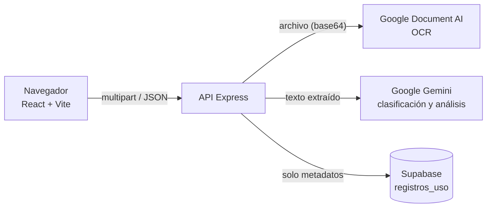

<p align="center">
  
</p>

# DocPilot

**Asistente de análisis documental con OCR e IA generativa, con revisión humana (Human-in-the-Loop).**

DocPilot permite cargar un documento (PDF, PNG, JPEG o TIFF), extraer su texto con **Google Cloud Document AI**, clasificarlo y analizarlo con **Google Gemini**, y mostrar al usuario un resultado estructurado (datos relevantes, alertas de fechas críticas y una sugerencia de respuesta o recomendación de acción) que **debe revisar y confirmar** antes de cualquier acción final.

> **Privacidad en una línea:** DocPilot no guarda los documentos en disco ni en su base de datos, pero sí los envía a Google (Document AI y Gemini) para procesarlos. Detalle completo en [docs/DATOS_Y_PRIVACIDAD.md](docs/DATOS_Y_PRIVACIDAD.md).

## Contenido

- [Funcionalidades](#funcionalidades)
- [Tecnologías](#tecnologías)
- [Arquitectura](#arquitectura)
- [Requisitos](#requisitos)
- [Instalación](#instalación)
- [Variables de entorno](#variables-de-entorno)
- [Configuración de servicios externos](#configuración-de-servicios-externos)
- [Ejecución](#ejecución)
- [Pruebas](#pruebas)
- [API](#api)
- [Estructura del proyecto](#estructura-del-proyecto)
- [Para desarrolladores](#para-desarrolladores)
- [Limitaciones conocidas](#limitaciones-conocidas)
- [Licencia](#licencia)

## Funcionalidades

- **Carga y validación de archivos** — PDF, PNG, JPEG y TIFF de hasta 10 MB. El backend valida el MIME declarado, la extensión, la firma real del contenido y la estructura del archivo (rechaza vacíos, truncados, corruptos o con el tipo falsificado). En PDF además limita a **100 páginas** (control de costo) y rechaza "bombas de descompresión".
- **OCR** con Google Cloud Document AI. Los PDF de más de 14 páginas se dividen automáticamente en memoria (`pdf-lib`) para respetar el límite de la API.
- **Clasificación y análisis en dos fases** con Gemini 2.5 Flash: primero se identifica la categoría (`contrato`, `factura`, `pqrs`, `documento_judicial`, `carta`, `cotizacion`, `otro`) y luego se aplica un prompt especializado que extrae los campos relevantes de esa categoría.
- **Human-in-the-Loop** — la IA solo propone. El usuario revisa el resultado junto al documento (vista dividida) y lo confirma explícitamente. El texto del botón cambia según el tipo de documento (*sugerencia de respuesta* o *recomendación de acción*).
- **Encuesta de utilidad opcional** tras confirmar (1–5 estrellas, tiempo ahorrado, comentario).
- **Panel de administración** protegido por token: métricas agregadas (documentos procesados, confirmados, valoración promedio, distribución por tipo, tiempo de procesamiento) y borrado de registros.
- **Errores honestos** — si falla el guardado en Supabase, el OCR o la IA, la API responde con el error correspondiente en lugar de simular un éxito. Si solo falla el registro de uso, el análisis se entrega con una advertencia explícita.

## Tecnologías

| Capa | Tecnología |
|------|-----------|
| Frontend | React 18 (componentes funcionales + Hooks), Vite 6 |
| Backend | Node.js (≥ 18), Express 4, Multer (memoryStorage), pdf-lib |
| OCR | Google Cloud Document AI (API REST, autenticación con `google-auth-library`) |
| IA | Google Gemini API (`@google/genai`, modelo `gemini-2.5-flash`) |
| Base de datos | Supabase (PostgreSQL) mediante `@supabase/supabase-js` |
| Pruebas | Jest + Supertest (backend) |
| Monorepo | npm workspaces (`backend`, `frontend`) |
| Despliegue de referencia | Railway (un único servicio que sirve API y frontend) |

## Arquitectura



Flujo resumido de `POST /api/documentos/analizar`:

1. **Validación** del archivo (tamaño, MIME, extensión, firma y estructura) — el archivo queda solo en memoria (`multer.memoryStorage()`).
2. **OCR** con Document AI (dividiendo PDF extensos).
3. **Clasificación + análisis** con Gemini.
4. **Registro de metadatos** en Supabase (tipo, tiempo, confirmado=false).
5. **Respuesta** al frontend para que el usuario revise (HITL). La confirmación y la encuesta llegan después, en endpoints separados.

Más detalle (flujo paso a paso, contratos de la API, códigos de error, decisiones de diseño) en [docs/ARQUITECTURA.md](docs/ARQUITECTURA.md).

## Requisitos

- Node.js 18 o superior y npm 9 o superior.
- Un proyecto de Supabase.
- Una cuenta de Google Cloud con Document AI habilitado y un procesador OCR.
- Una API key de Gemini (Google AI Studio).

Para solo ejecutar las pruebas no necesitas ninguna cuenta externa.

## Instalación

```bash
git clone https://github.com/mandresjacome/docpilot.git
cd docpilot
npm install        # instala backend y frontend (npm workspaces)
```

Crea los archivos de entorno a partir de las plantillas:

```bash
cp backend/.env.example backend/.env
cp frontend/.env.example frontend/.env.local    # opcional en desarrollo
```

En Windows (PowerShell): `Copy-Item backend\.env.example backend\.env`.

## Variables de entorno

### Backend (`backend/.env`)

| Variable | Obligatoria | Descripción |
|----------|:-----------:|-------------|
| `SUPABASE_URL` | Sí (al arrancar) | URL del proyecto Supabase. |
| `SUPABASE_SERVICE_KEY` | Sí (al arrancar) | Clave `service_role`. **Solo backend; nunca en el frontend.** |
| `GEMINI_API_KEY` | Sí (al analizar) | API key de Gemini. |
| `DOCUMENT_AI_PROJECT_ID` | Sí (al analizar) | ID del proyecto de Google Cloud. |
| `DOCUMENT_AI_LOCATION` | Sí (al analizar) | Región del procesador (`us` o `eu`). |
| `DOCUMENT_AI_PROCESSOR_ID` | Sí (al analizar) | ID del procesador OCR. |
| `GOOGLE_APPLICATION_CREDENTIALS` | Desarrollo | Ruta al JSON de la cuenta de servicio (p. ej. `./credenciales/gcp-service-account.json`; la carpeta está en `.gitignore`). |
| `GOOGLE_CREDENTIALS_JSON` | Producción | Contenido completo del JSON de la cuenta de servicio. Tiene prioridad sobre la anterior. |
| `ADMIN_TOKEN` | Para el panel admin | Secreto largo y aleatorio (`openssl rand -hex 32`). Si falta, el panel responde 503. |
| `NODE_ENV` | Producción | `production` sirve el frontend compilado y desactiva CORS. |
| `PORT` | No | Por defecto `3001`. |

### Frontend (`frontend/.env.local`)

| Variable | Descripción |
|----------|-------------|
| `VITE_API_URL` | Base de la API **incluyendo `/api`**. Déjala vacía en desarrollo (el proxy de Vite reenvía `/api` a `localhost:3001`) y en producción con mismo origen. Solo se define si el backend vive en otro dominio. |

> Nunca subas `.env`, `.env.local` ni el JSON de credenciales. Todos están en `.gitignore`.

## Configuración de servicios externos

### Supabase

1. Crea un proyecto y ejecuta el esquema de [docs/supabase-schema.sql](docs/supabase-schema.sql) en el *SQL Editor* (crea la tabla `registros_uso`).
2. Copia la **URL** y la clave **service_role** (Project Settings → API) a `SUPABASE_URL` y `SUPABASE_SERVICE_KEY`.

### Google Cloud Document AI

1. Habilita la API *Cloud Document AI* en tu proyecto.
2. Crea un procesador de tipo **Document OCR** y anota su ID y su región.
3. Crea una cuenta de servicio con el rol **Document AI API User** y descarga su clave JSON.
4. Desarrollo: guarda el JSON en `backend/credenciales/` y apunta `GOOGLE_APPLICATION_CREDENTIALS` a él. Producción: pega su contenido en `GOOGLE_CREDENTIALS_JSON`.

### Gemini

Genera una API key en [Google AI Studio](https://aistudio.google.com/) y colócala en `GEMINI_API_KEY`. Revisa en los términos vigentes de la API qué ocurre con el contenido enviado según uses el nivel gratuito o de pago (ver [docs/DATOS_Y_PRIVACIDAD.md](docs/DATOS_Y_PRIVACIDAD.md)).

## Ejecución

```bash
npm run dev            # backend (nodemon, :3001) y frontend (Vite, :5173) a la vez
# o por separado:
npm run dev:backend
npm run dev:frontend
```

Abre <http://localhost:5173>. Vite reenvía `/api/*` al backend, por lo que en desarrollo no hay solicitudes cross-origin.

Build y ejecución tipo producción (un único proceso):

```bash
npm run build                       # genera frontend/dist
NODE_ENV=production npm start       # Express sirve la API y el frontend compilado
# PowerShell: $env:NODE_ENV = 'production'; npm start
```

Guía de despliegue en Railway: [docs/DESPLIEGUE.md](docs/DESPLIEGUE.md).

## Pruebas

```bash
npm test                                   # toda la suite del backend
npm run test:coverage --workspace=backend  # con informe de cobertura
```

La suite usa **Jest + Supertest** y **simula todos los servicios externos** (Supabase, Document AI, Gemini): no consume cuotas ni necesita credenciales. Cubre:

- Carga y validación de archivos (firmas, extensión, tamaño, archivos vacíos, truncados o manipulados, bombas de descompresión y tope de 100 páginas en PDF).
- OCR: división de PDF, errores de Document AI, respuestas inválidas.
- IA: clasificación, limpieza del JSON, respuestas vacías o mal formadas, fallos de la API.
- Registro en Supabase: éxito, errores devueltos y excepciones de red, ausencia de datos de contacto.
- Rutas de documentos de extremo a extremo (analizar → confirmar → encuesta) y su manejo de errores.
- Protección de rutas administrativas (401/503/404/502, token en tiempo constante).
- CORS (preflight de `DELETE`, orígenes y headers permitidos) y el manejador global de errores.

El frontend no tiene pruebas automatizadas todavía.

## API

| Método | Ruta | Descripción |
|--------|------|-------------|
| `POST` | `/api/documentos/analizar` | Recibe `multipart/form-data` (campo `documento`), ejecuta OCR + IA y devuelve el análisis. |
| `POST` | `/api/documentos/confirmar` | Cierra el ciclo HITL y marca el registro como confirmado. |
| `POST` | `/api/documentos/encuesta` | Guarda la valoración del usuario. |
| `POST` | `/api/visitas/registrar` | Registra en el log del servidor que se aceptó el tratamiento de datos (sin datos personales). |
| `GET` | `/api/admin/dashboard` | Métricas agregadas. Header `x-admin-token`. |
| `DELETE` | `/api/admin/registros/:id` | Elimina un registro. Header `x-admin-token`. |
| `DELETE` | `/api/admin/registros` | Elimina todos los registros. Header `x-admin-token`. |

Los errores devuelven `{ "error": "mensaje", "codigo": "CODIGO_ESTABLE" }`. Contratos y códigos en [docs/ARQUITECTURA.md](docs/ARQUITECTURA.md#contratos-de-la-api).

## Estructura del proyecto

```
docpilot/
├── backend/
│   ├── app.js                      # configuración de Express (CORS, rutas, estáticos, errores)
│   ├── server.js                   # arranque (separado de app.js para poder testear)
│   ├── config/cors.js              # orígenes, métodos y headers de CORS (desarrollo)
│   ├── routes/                     # URL → controlador (sin lógica)
│   ├── controllers/                # orquestación de cada petición
│   ├── services/
│   │   ├── ocr.service.js          # Google Document AI
│   │   ├── gemini.service.js       # clasificación y análisis con Gemini
│   │   ├── supabase.service.js     # persistencia de metadatos (errores tipados)
│   │   ├── validacionArchivo.service.js  # firma, extensión, estructura y tope de páginas
│   │   └── seguridadPDF.service.js # defensa contra bombas de descompresión en PDF
│   ├── middlewares/                # validarArchivo (multer + validación), errorHandler
│   ├── utils/errores.js            # ErrorApp (estado HTTP + código estable) y esUUID
│   └── tests/                      # Jest + Supertest, con helpers y mocks
├── frontend/
│   └── src/
│       ├── pages/                  # PaginaAnalisis, PaginaAdmin, PaginaAcercaDe
│       ├── components/             # formulario, vista dividida, resultado, encuesta, modal
│       └── services/               # capa fetch hacia la API
├── docs/                           # arquitectura, datos y privacidad, despliegue, esquema SQL
├── .github/                        # instrucciones para asistentes de código del repositorio
├── railway.json                    # configuración de build/arranque para Railway
└── package.json                    # raíz del monorepo (workspaces y scripts)
```

## Para desarrolladores

- **Orden de lectura sugerido:** `backend/app.js` → `routes/documento.routes.js` → `middlewares/validarArchivo.js` → `controllers/documento.controller.js` → `services/*`.
- **Convención de errores:** los servicios lanzan `ErrorApp` (`utils/errores.js`) con estado y código; los controladores hacen `next(error)`; `middlewares/errorHandler.js` los convierte en JSON, registra siempre los 5xx y, en producción, oculta el detalle de errores no controlados.
- **Añadir una categoría de documento:** agrégala a `CATEGORIAS` y define su prompt en `PROMPTS_POR_TIPO` (`services/gemini.service.js`); el frontend renderiza los campos dinámicamente en `ResultadoAnalisis.jsx`. Añade una prueba en `tests/gemini.service.test.js`.
- **Reglas de contribución para asistentes de código:** ver [.github/instrucciones.md](.github/instrucciones.md).

## Limitaciones conocidas

- Los documentos **sí** se envían a servicios de terceros (Google). "Sin persistencia" describe a DocPilot, no a esos servicios.
- La validación de archivos es **estructural**: detecta archivos falsificados, truncados o dañados, pero no decodifica cada píxel ni cada objeto interno; esa comprobación final la hace Document AI. La defensa contra bombas de descompresión en PDF es una defensa en profundidad, no una garantía absoluta: en una exposición pública combínala con límites de memoria del contenedor y *rate limiting*.
- Los PDF están limitados a 100 páginas por documento.
- Los endpoints de análisis **no tienen autenticación ni límite de peticiones**: cualquiera con acceso a la URL puede consumir cuota de Document AI y Gemini. Para uso público añade autenticación y *rate limiting*.
- El panel admin usa un único token compartido (sin usuarios, expiración ni bloqueo por intentos).
- Los resultados de la IA pueden contener errores; por eso existe el paso de revisión humana. No sustituyen asesoría legal ni contable.

## Licencia

Distribuido bajo la licencia **MIT**. Consulta el archivo [LICENSE](LICENSE).

## Autor

**Mario Andrés Jácome** — [@mandresjacome](https://github.com/mandresjacome)
