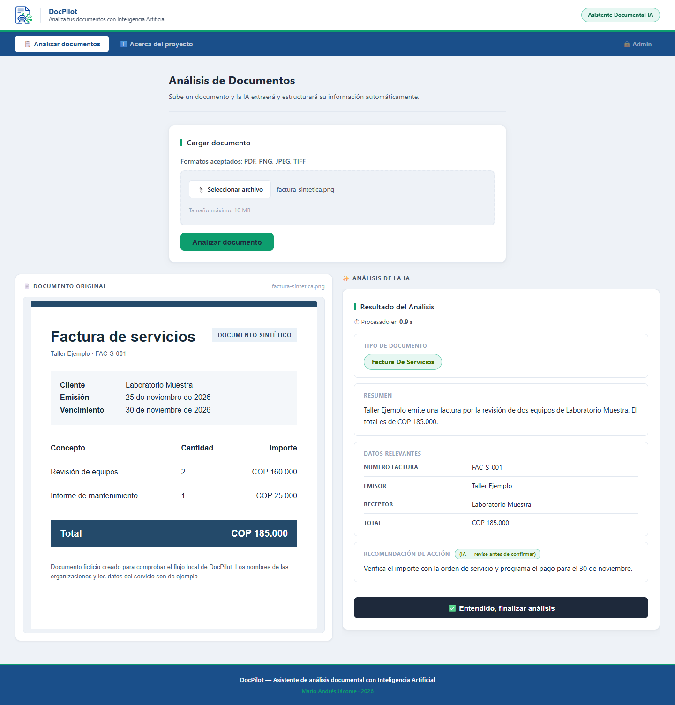
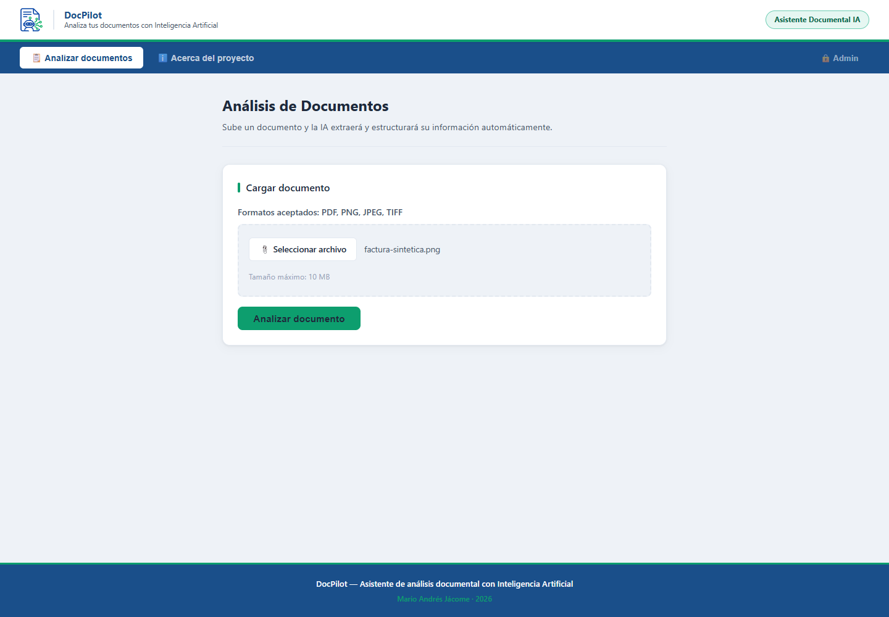
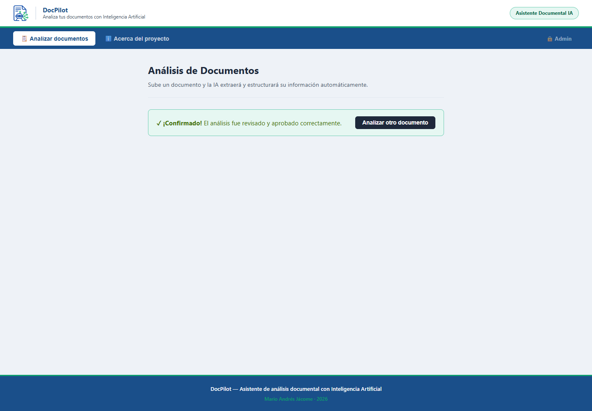
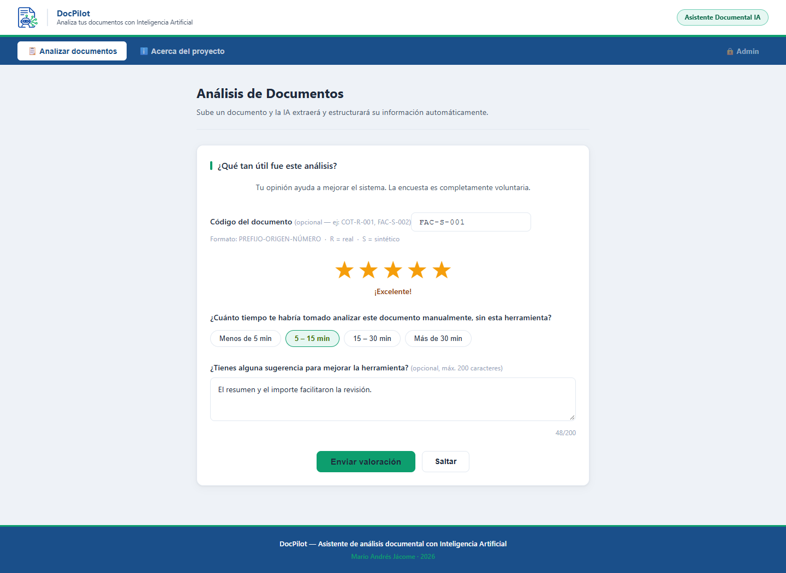
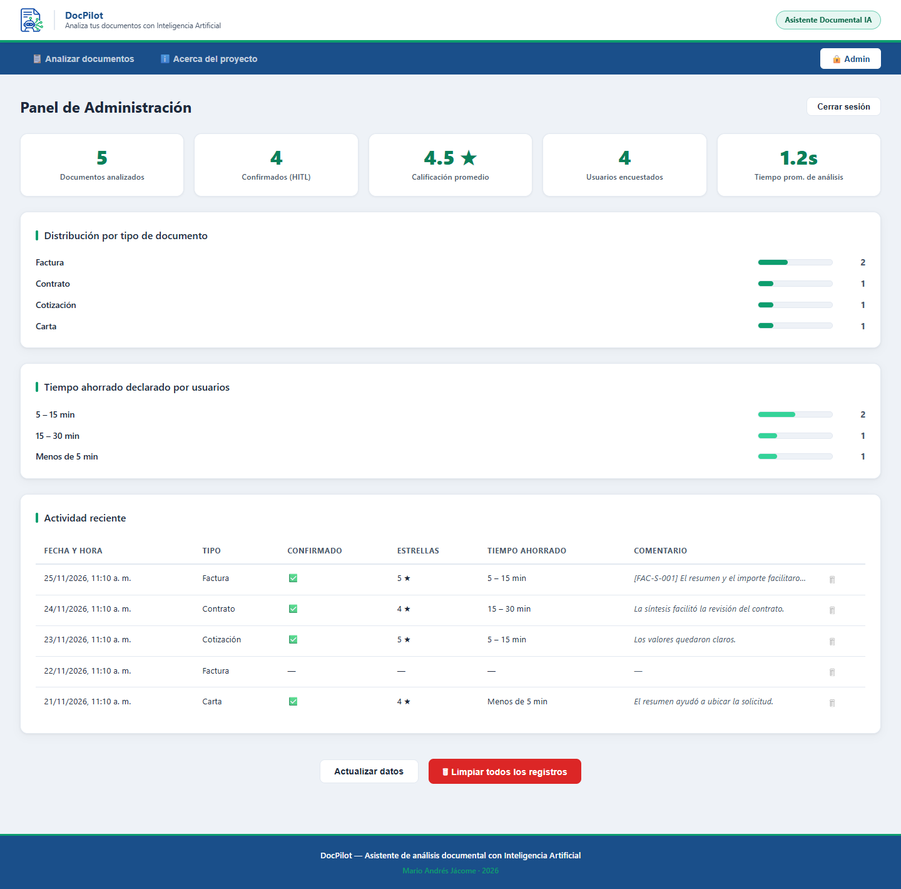

<p align="center">
  
</p>

# DocPilot

Aplicación web para revisar documentos con OCR e IA generativa. DocPilot extrae el texto de un archivo, identifica su categoría y presenta el documento junto a un análisis estructurado. La persona usuaria revisa el resultado y decide si confirma. Después puede enviar una valoración opcional.

El frontend usa React y Vite. La API de Express coordina Google Cloud Document AI para OCR, Gemini para clasificación y análisis, y Supabase para los metadatos de uso. La confirmación registra la revisión humana. El panel administrativo permite consultar métricas y eliminar registros.

## Capturas

Capturas de la interfaz real ejecutada en local con **un documento sintético y servicios simulados**. El texto extraído, el análisis y los registros de ejemplo provienen de respuestas preparadas para la prueba, sin procesamiento real de Google.

[](docs/capturas/02-analisis.png)

| Carga del documento | Revisión humana confirmada |
| --- | --- |
| [](docs/capturas/01-carga.png) | [](docs/capturas/03-confirmacion.png) |
| **Encuesta de utilidad** | **Panel administrativo** |
| [](docs/capturas/04-encuesta.png) | [](docs/capturas/05-admin.png) |

## Instalación local

Se requiere **Node.js 24.15 o posterior dentro de la serie 24** y **npm 11**. Ejecuta los comandos desde la raíz del repositorio.

```bash
npm ci
npm run lint
npm test
npm run build
```

Estos comandos usan el lockfile y requieren acceso al registro npm para instalar dependencias. Las pruebas usan archivos sintéticos y simulan los servicios externos, por lo que pueden ejecutarse sin credenciales de DocPilot.

### Ejecutar la aplicación

Para usar el flujo con proveedores reales, copia `backend/.env.example` a `backend/.env`. En macOS o Linux usa `cp backend/.env.example backend/.env`. En PowerShell usa `Copy-Item backend\.env.example backend\.env`. Si PowerShell bloquea `npm.ps1`, usa `npm.cmd`.

| Variable | Configuración |
| --- | --- |
| `SUPABASE_URL` y `SUPABASE_SERVICE_KEY` | URL del proyecto y clave `service_role` del servidor. Aplica el [esquema SQL](docs/supabase-schema.sql) al proyecto antes de analizar. |
| `DOCUMENT_AI_PROJECT_ID`, `DOCUMENT_AI_LOCATION` y `DOCUMENT_AI_PROCESSOR_ID` | Proyecto, región e identificador de un procesador Document OCR. |
| `GOOGLE_APPLICATION_CREDENTIALS` o `GOOGLE_CREDENTIALS_JSON` | Cuenta de servicio con acceso a Document AI. Las rutas relativas se resuelven desde `backend/`. El JSON directo tiene prioridad si se configura. |
| `GEMINI_API_KEY` | Clave del servidor para la API de Gemini. |
| `GEMINI_MODEL` | Opcional. Predeterminado `gemini-3.5-flash-lite`. Un modelo alternativo debe admitir generación de texto y salida JSON estructurada. |
| `ADMIN_TOKEN` | Secreto largo y aleatorio. El panel queda deshabilitado si está vacío. |
| `HOST` y `PORT` | Dirección y puerto del backend. Predeterminados `127.0.0.1` y `3001`. |
| `NODE_ENV` | `development` para trabajar con Vite. Con `production`, Express sirve también el frontend compilado. |

El backend lee `backend/.env` tanto desde la raíz como desde `backend/`. Las variables del proceso tienen precedencia. Mantén las credenciales fuera del repositorio y de las variables `VITE_*`, que son visibles en el navegador.

```bash
npm run dev
```

Abre <http://localhost:5173>. Vite reenvía `/api` a `127.0.0.1:3001`. Puedes ejecutar los procesos por separado con `npm run dev:backend` y `npm run dev:frontend`. `frontend/.env.local` es opcional. `VITE_API_URL` permite indicar una URL de API que incluya `/api`.

Puedes comprobar el frontend compilado y la API desde un mismo origen.

```bash
npm run build
NODE_ENV=production npm start
```

En PowerShell, establece `$env:NODE_ENV = 'production'` y ejecuta `npm.cmd start`. Con la configuración predeterminada, abre <http://127.0.0.1:3001>.

## Flujo y límites

- **Carga y análisis.** Una parte multipart con un PDF, PNG, JPEG o TIFF de hasta 10 MiB. El PDF admite hasta 100 páginas. La API valida estructura y formato, aplica límites a imágenes y permite hasta cinco solicitudes por ventana de un minuto y dos análisis simultáneos por proceso.
- **Revisión humana.** El análisis devuelve un permiso firmado ligado a su registro. El permiso dura una hora o hasta que se reinicie el backend. La confirmación usa el permiso y el identificador, sin reenviar el contenido del análisis. La encuesta admite una única valoración por registro confirmado.
- **Administración.** La API exige `x-admin-token` y aplica hasta 25 solicitudes por minuto por proceso. Las métricas se calculan sobre **los 500 registros más recientes como máximo**. La actividad reciente muestra hasta diez filas de ese conjunto.
- **Privacidad.** El archivo va a Document AI y el texto extraído va a Gemini. DocPilot procesa el archivo en memoria y conserva en Supabase la categoría validada, el tiempo, el estado de confirmación y la valoración opcional. Los comentarios son texto libre. Los logs de errores de la aplicación incluyen estado y código, sin contenido documental.

La dirección de escucha predeterminada limita el alcance a la máquina local. Establecer un `HOST` accesible por red permite que clientes de esa red alcancen los endpoints de análisis. Los límites se aplican por proceso.

## Calidad automatizada

| Comando | Qué ejecuta |
| --- | --- |
| `npm run lint` | ESLint en ambos workspaces con cero advertencias permitidas. |
| `npm test` | Backend con Jest y Supertest. Frontend con Vitest y Testing Library. |
| `npm run test:backend` / `npm run test:frontend` | Suite de un workspace desde la raíz. |
| `npm run test:coverage --workspace=backend` | Informe de cobertura del backend. |
| `npm run build` | Compilación de React con Vite. |

[GitHub Actions](.github/workflows/ci.yml) ejecuta la instalación limpia, lint, las dos suites y la compilación en Linux con Node.js 24. Solo necesita acceso de lectura al repositorio y acceso a las dependencias públicas. Los tests cubren validación documental, controles de API, revisión humana, encuesta, permisos vencidos y recuperación ante fallos del backend.

La verificación de esta versión se hizo con documentos sintéticos y servicios simulados. La integración real con Document AI, Gemini y Supabase quedó fuera de esta verificación.

Más detalles en [arquitectura y contratos de la API](docs/ARQUITECTURA.md), [datos y privacidad](docs/DATOS_Y_PRIVACIDAD.md) y [esquema de Supabase](docs/supabase-schema.sql).

## Licencia y autor

Mario Andrés Jácome Mantilla · [@mandresjacome](https://github.com/mandresjacome) · [Licencia MIT](LICENSE)
