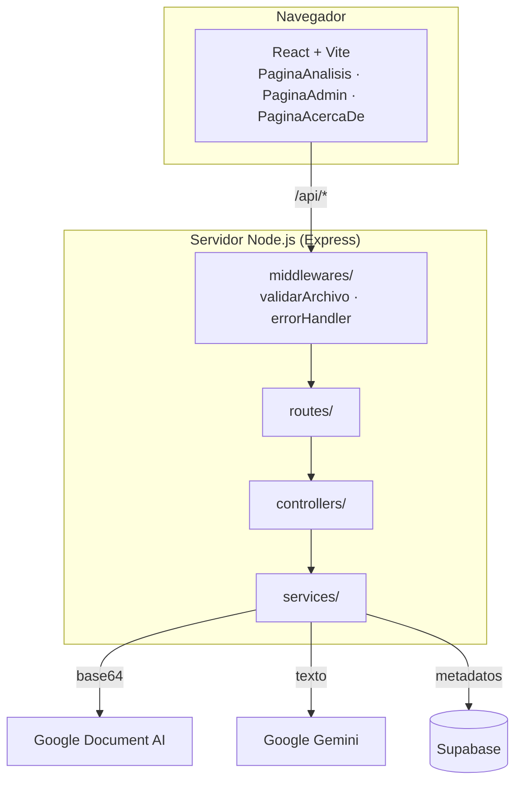

# Arquitectura

Guía técnica de DocPilot: qué archivo hace qué, cómo viaja una petición, qué contrato tiene la API y por qué se tomaron las decisiones principales.

## Vista general



Reglas de capas (se respetan en todo el backend):

| Capa | Responsabilidad | No debe |
|------|-----------------|---------|
| `routes/` | Mapear verbo + URL a un controlador | Contener lógica |
| `controllers/` | Orquestar una petición y responder | Hablar con APIs externas directamente |
| `services/` | Integraciones y lógica (OCR, IA, Supabase, validación) | Conocer `req`/`res` |
| `middlewares/` | Validación de entrada y manejo global de errores | — |

Express escucha en `127.0.0.1:3001` por defecto. En producción sirve también `frontend/dist` desde el mismo origen. En desarrollo, el proxy de Vite reenvía `/api` a esa dirección.

## Flujo de `POST /api/documentos/analizar`

```
[1] El usuario elige un archivo → FormularioDocumento valida tipo y tamaño en el cliente.
[2] documento.service.js envía un FormData (campo "documento") a /api/documentos/analizar.
[3] Control de origen, cabecera de análisis y límites de frecuencia y concurrencia.
      ├─ multer (memoryStorage): máx. 10 MiB, una sola parte "documento", MIME permitido.
      └─ validacionArchivo.service.js: no vacío · extensión permitida · firma real = MIME declarado ·
         extensión coherente con el contenido · estructura íntegra (PDF/PNG/JPEG/TIFF).
         Si algo falla → 400 con código estable. El flujo termina aquí.
[4] documento.controller.js · analizar()
      ├─ ocr.service.extraerTexto(buffer, mime)
      │     PDF > 14 páginas → se divide en memoria (pdf-lib) y se envía por trozos.
      │     Cada trozo se envía en base64 a Document AI (HTTPS nativo). Textos concatenados.
      ├─ gemini.service.analizarTexto(texto)
      │     Fase 1: clasificación (muestra del texto) → categoría.
      │     Fase 2: prompt especializado + texto completo → JSON del análisis.
      └─ supabase.service.registrarUsoConRetorno({ tipo_documento, tiempo_ms, confirmado: false })
            Si falla: el análisis se entrega igualmente con registro.guardado = false.
[5] Respuesta 200 { mensaje, datos, registroId, permisoAnalisis, registro } → VistaDividida.
[6] El usuario revisa y pulsa el botón de confirmación → POST /api/documentos/confirmar.
      Si falla el guardado → 502 y el usuario puede reintentar.
[7] Encuesta opcional → POST /api/documentos/encuesta. Si falla se informa; el usuario puede reintentar u omitir.
```

El endpoint `/analizar` **nunca ejecuta una acción final**: solo devuelve la propuesta de la IA (Human-in-the-Loop). La acción de cierre es `/confirmar`, que el frontend llama únicamente tras el clic explícito del usuario.

## Contratos de la API

### `POST /api/documentos/analizar`

Petición `multipart/form-data` con un único campo de archivo `documento` y cabecera `x-docpilot-analysis: 1`.

Respuesta `200`:

```json
{
  "mensaje": "Documento analizado correctamente. Por favor revise el resultado.",
  "datos": { "tipo": "...", "resumen": "...", "datosRelevantes": {}, "alertas": null, "sugerenciaRespuesta": "...", "_categoria": "factura" },
  "registroId": "uuid",
  "permisoAnalisis": "permiso temporal",
  "registro": { "guardado": true }
}
```

Si Supabase falla, la respuesta sigue siendo `200` pero con `registroId: null` y
`registro: { "guardado": false, "advertencia": "..." }`; el mensaje también lo indica. Los campos de `datos` varían según la categoría (los define el prompt de cada tipo en `gemini.service.js`).

### `POST /api/documentos/confirmar`

Envía `registroId` (UUID o `null`) y `permisoAnalisis` devueltos por el análisis. El permiso está firmado y dura una hora o hasta que se reinicia el backend. La respuesta `200` incluye `mensaje` y `registroActualizado`. Si falló el guardado inicial, `registroActualizado` es `false`. Confirmar de nuevo un registro ya confirmado conserva el éxito sin repetir la escritura.

### `POST /api/documentos/encuesta`

Envía `registroId`, `permisoAnalisis`, `estrellas` (entero de 1 a 5) y, opcionalmente, `tiempo_ahorrado` y `comentario` (hasta 200 caracteres). Se guarda una sola valoración por registro confirmado. La respuesta `200` incluye `mensaje`. La escritura condicional en Supabase protege también frente a peticiones concurrentes.

### `POST /api/visitas/registrar`

Sin cuerpo relevante (se ignora). Escribe una línea de log sin datos personales. Respuesta `200`.

### Rutas `/api/admin/*`

Requieren la cabecera `x-admin-token`. El token se compara en tiempo constante y el router admite hasta 25 solicitudes por minuto por proceso. Un token ausente o incorrecto devuelve `401`. El panel sin `ADMIN_TOKEN` configurado devuelve `503`.

- `GET /dashboard` → `{ metricas: {...}, actividadReciente: [...] }`
- `DELETE /registros/:id` → borra un registro (`id` debe ser UUID).
- `DELETE /registros` → borra todos los registros.

Las métricas de `GET /dashboard` se calculan sobre los 500 registros más recientes como máximo, ordenados por fecha. Campos como `totalProcesados` representan ese conjunto. La actividad reciente devuelve sus primeras diez filas.

### Formato de error

```json
{ "error": "Mensaje en español apto para el usuario", "codigo": "CODIGO_ESTABLE" }
```

| Estado | Códigos | Origen |
|:------:|---------|--------|
| 400 | `ARCHIVO_REQUERIDO`, `CAMPO_ARCHIVO_INVALIDO`, `CARGA_INVALIDA`, `ARCHIVO_DEMASIADO_GRANDE`, `TIPO_NO_PERMITIDO`, `EXTENSION_NO_PERMITIDA`, `ARCHIVO_VACIO`, `CONTENIDO_NO_RECONOCIDO`, `CONTENIDO_NO_COINCIDE`, `EXTENSION_NO_COINCIDE`, `ARCHIVO_DANADO`, `PDF_DEMASIADO_EXTENSO` | Validación del archivo |
| 400 | `ERROR_SOLICITUD`, `REGISTRO_ID_REQUERIDO`, `REGISTRO_ID_INVALIDO`, `ESTRELLAS_INVALIDAS`, `ENCUESTA_INVALIDA` | Validación de cuerpos y parámetros |
| 403 | `SOLICITUD_ANALISIS_NO_AUTORIZADA`, `PERMISO_ANALISIS_INVALIDO` | Origen o cabecera no permitidos, o permiso ausente, inválido o vencido |
| 404 | `REGISTRO_NO_ENCONTRADO` | El registro no existe |
| 409 | `ANALISIS_NO_CONFIRMADO`, `ENCUESTA_YA_REGISTRADA`, `ESTADO_REGISTRO_CAMBIO` | Estado del registro incompatible con la escritura |
| 413 | `SOLICITUD_DEMASIADO_GRANDE` | El cuerpo JSON supera el límite |
| 422 | `PDF_ILEGIBLE`, `OCR_SIN_TEXTO`, `PDF_DEMASIADO_EXTENSO`, `TEXTO_DEMASIADO_EXTENSO` | El documento no se puede leer o supera un límite de procesamiento |
| 429 | `LIMITE_PETICIONES`, `ANALISIS_OCUPADO` | Límite de frecuencia o de concurrencia |
| 502 | `OCR_FALLIDO`, `OCR_RESPUESTA_INVALIDA`, `OCR_NO_DISPONIBLE`, `OCR_AUTENTICACION_FALLIDA` | Document AI |
| 502 | `IA_NO_DISPONIBLE`, `IA_RESPUESTA_VACIA`, `IA_RESPUESTA_INVALIDA` | Gemini |
| 502 | `PERSISTENCIA_FALLIDA` | Supabase |
| 500 | `ERROR_INTERNO` | Error inesperado |
| 503 | `OCR_NO_CONFIGURADO`, `IA_NO_CONFIGURADA` | Falta configuración del proveedor |

La respuesta y los logs excluyen el detalle técnico de los fallos de proveedores.

## Manejo de errores

- Los servicios lanzan `ErrorApp` (`utils/errores.js`) con `status`, `codigo` y un mensaje seguro.
- Los controladores usan `try/catch` + `next(error)`.
- `middlewares/errorHandler.js` responde en JSON, registra los 5xx con estado y código y envía un mensaje genérico para errores de bibliotecas o inesperados.
- Principio: **una operación fallida nunca responde como exitosa**. La única excepción deliberada es el registro de uso en `/analizar`, que no invalida un análisis ya hecho y se comunica con `registro.guardado: false`.

## Validación de archivos

`middlewares/validarArchivo.js` combina dos capas:

1. **multer** con un máximo de 10 MiB, una sola parte de archivo, nombre de campo y MIME permitido. La frecuencia y la concurrencia se verifican antes de leer el archivo.
2. **`validacionArchivo.service.js`** (sobre el buffer):
   - firma real (`%PDF-`, PNG, JPEG, TIFF) y coincidencia con el MIME declarado y con la extensión;
   - PDF: marcador `%%EOF`; **recorrido previo de los flujos comprimidos** (`seguridadPDF.service.js`), que los infla en streaming para contar bytes y rechaza el archivo si un flujo supera 100 MB inflados o el total 200 MB (bomba de descompresión: un PDF de < 1 MB puede inflarse a cientos de MB al parsearlo); carga con `pdf-lib` (rechaza cifrados o ilegibles); máximo **100 páginas** (`PDF_DEMASIADO_EXTENSO`), porque cada 14 páginas es una llamada de pago a Document AI;
   - PNG estático con CRC-32, `IHDR`, `IDAT`, `IEND` y hasta 40 megapíxeles;
   - JPEG con marcadores, dimensiones en `SOF`, `SOS`, marcador de fin y hasta 40 megapíxeles;
   - TIFF con recorrido de la cadena de directorios y hasta 14 páginas, 40 megapíxeles por página y 120 en total. Se rechazan ciclos y subdirectorios de imagen.

Es validación **estructural**: no decodifica la imagen completa (eso lo hace Document AI).

## CORS

`config/cors.js`; solo se activa si `NODE_ENV !== 'production'`.

- Orígenes locales en los puertos 5173 y 4173, con `localhost` o `127.0.0.1`.
- Métodos: `GET`, `POST`, `DELETE` (el panel admin usa `DELETE`).
- Cabeceras permitidas `Content-Type`, `x-admin-token` y `x-docpilot-analysis`.
- Sin `*` y sin credenciales. En desarrollo normal no interviene, porque el proxy de Vite evita las solicitudes cross-origin; importa si `VITE_API_URL` apunta directamente a `:3001`.

## Seguridad

Resumen de las defensas implementadas y de sus límites (revisadas en una auditoría de seguridad del repositorio):

| Riesgo | Defensa | Límite |
|--------|---------|--------|
| Archivos falsificados o manipulados | Firma real + extensión + estructura (`validacionArchivo.service.js`) | Validación estructural, no decodificación completa |
| Bomba de descompresión en PDF | Recorrido previo que infla los flujos en streaming con tope por flujo (100 MB) y total (200 MB) | Defensa en profundidad; un PDF diseñado para confundir el recorrido podría evadirla. Usa además límites de memoria del contenedor |
| Consumo de OCR y Gemini | Loopback por defecto, hasta 5 solicitudes por minuto y 2 simultáneas antes de Multer, y máximo 100 páginas PDF | Límites por proceso. La cabecera comprueba el flujo de navegador y cualquier cliente local puede enviarla |
| Escritura en registros ajenos | Permiso firmado ligado al UUID, vigente durante una hora, y transiciones condicionales | Los permisos pendientes vencen al reiniciar |
| Peticiones colgadas | Tiempo de espera de 60 s por llamada a Document AI y 90 s en Gemini. La desconexión interrumpe el trabajo local pendiente | El proveedor puede haber recibido ya la llamada |
| Acceso al panel admin | Token en cabecera, comparación en tiempo constante, 503 si está desactivado y 25 solicitudes por minuto | Token compartido, sin expiración propia |
| Divulgación de errores | Mensajes seguros por `ErrorApp` y logs de fallos limitados a estado y código | — |
| Secretos | `.env` y credenciales ignorados por Git; el historial se revisó sin hallazgos | — |

## Servicios de IA

- **`ocr.service.js`** usa HTTPS nativo y `google-auth-library`. Los PDF se procesan en trozos de hasta 14 páginas. La API devuelve solo el campo de texto y el backend limita el cuerpo de cada respuesta a 4 MiB.
- **`gemini.service.js`** hace una llamada de clasificación y otra con un prompt especializado y salida JSON estructurada. Valida tipos y longitudes localmente, usa la fecha actual como contexto y admite configurar `GEMINI_MODEL` (por defecto, `gemini-3.5-flash-lite`).

Categorías y campos principales:

| Categoría | Campos clave |
|-----------|--------------|
| `contrato` | Partes, objeto, valor y pago, vigencia, obligaciones, cláusulas de riesgo, jurisdicción |
| `factura` | Número, emisor, receptor, fechas, subtotal, impuestos, total, estado de pago |
| `pqrs` | Remitente, motivo, solicitud, plazo legal, fecha límite |
| `documento_judicial` | Autoridad, expediente, partes, orden principal, plazos, consecuencias |
| `carta` | Remitente, destinatario, asunto, acción requerida |
| `cotizacion` | Proveedor, cliente, vigencia, ítems, total, condiciones, tiempo de entrega |
| `otro` | Análisis genérico |

## Pruebas

Jest + Supertest en `backend/tests`. Los servicios externos se simulan con:

- `helpers/supabaseMock.js`: cliente encadenable de Supabase con respuestas y excepciones configurables.
- `jest.mock('https')` y `jest.mock('google-auth-library')` para Document AI.
- `jest.mock('@google/genai')` para Gemini.
- `helpers/archivos.js`: genera PDF/PNG/JPEG/TIFF válidos en memoria y permite corromperlos.
- `setup.js`: variables de entorno ficticias; ninguna prueba usa credenciales reales.

## Decisiones de diseño

| Decisión | Motivo |
|----------|--------|
| `multer.memoryStorage()` | Los archivos no se escriben en disco; simplifica y reduce la superficie de datos. |
| División de PDF con `pdf-lib` en memoria | Superar el límite de páginas de Document AI sin archivos temporales. |
| `app.js` separado de `server.js` | Permite importar la app en pruebas sin abrir un puerto. |
| Dos fases de Gemini | Clasificar primero permite aplicar un prompt especializado por tipo. |
| Supabase con `service_role` solo en backend | El frontend nunca ve la clave; RLS activado sin políticas bloquea otros accesos. |
| Sin persistencia del contenido | Menor riesgo de privacidad; ver [DATOS_Y_PRIVACIDAD.md](DATOS_Y_PRIVACIDAD.md). |
| Token admin comparado en tiempo constante | Evita revelar el secreto por diferencias de tiempo de respuesta. |
