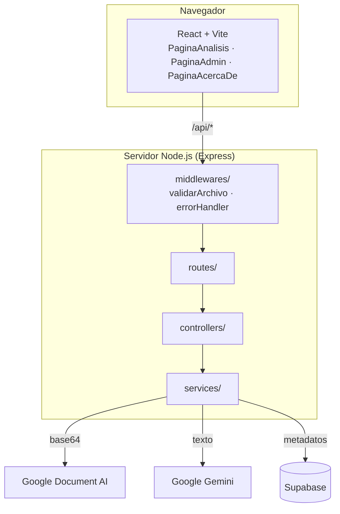

# Arquitectura

Guía técnica de DocPilot: qué archivo hace qué, cómo viaja una petición, qué contrato tiene la API y por qué se tomaron las decisiones principales.

## Vista general



Reglas de capas (se respetan en todo el backend):

| Capa | Responsabilidad | No debe |
|------|-----------------|---------|
| `routes/` | Mapear verbo + URL a un controlador | Contener lógica |
| `controllers/` | Orquestar una petición y responder | Hablar con APIs externas directamente |
| `services/` | Integraciones y lógica (OCR, IA, Supabase, validación) | Conocer `req`/`res` |
| `middlewares/` | Validación de entrada y manejo global de errores | — |

En producción Express sirve también `frontend/dist` (mismo origen: sin CORS). En desarrollo, el proxy de Vite reenvía `/api` a `localhost:3001`.

## Flujo de `POST /api/documentos/analizar`

```
[1] El usuario elige un archivo → FormularioDocumento valida tipo y tamaño en el cliente.
[2] documento.service.js envía un FormData (campo "documento") a /api/documentos/analizar.
[3] middlewares/validarArchivo.js
      ├─ multer (memoryStorage): máx. 10 MB, 1 archivo, campo "documento", MIME permitido.
      └─ validacionArchivo.service.js: no vacío · extensión permitida · firma real = MIME declarado ·
         extensión coherente con el contenido · estructura íntegra (PDF/PNG/JPEG/TIFF).
         Si algo falla → 400 con código estable. El flujo termina aquí.
[4] documento.controller.js · analizar()
      ├─ ocr.service.extraerTexto(buffer, mime)
      │     PDF > 14 páginas → se divide en memoria (pdf-lib) y se envía por trozos.
      │     Cada trozo se envía en base64 a Document AI (HTTPS nativo). Textos concatenados.
      ├─ gemini.service.analizarTexto(texto)
      │     Fase 1: clasificación (muestra del texto) → categoría.
      │     Fase 2: prompt especializado + texto completo → JSON del análisis.
      └─ supabase.service.registrarUsoConRetorno({ tipo, tiempo_ms, confirmado: false })
            Si falla: el análisis se entrega igualmente con registro.guardado = false.
[5] Respuesta 200 { mensaje, datos, registroId, registro } → VistaDividida (documento | análisis).
[6] El usuario revisa y pulsa el botón de confirmación → POST /api/documentos/confirmar.
      Si falla el guardado → 502 y el usuario puede reintentar.
[7] Encuesta opcional → POST /api/documentos/encuesta. Si falla se informa; el usuario puede reintentar u omitir.
```

El endpoint `/analizar` **nunca ejecuta una acción final**: solo devuelve la propuesta de la IA (Human-in-the-Loop). La acción de cierre es `/confirmar`, que el frontend llama únicamente tras el clic explícito del usuario.

## Contratos de la API

### `POST /api/documentos/analizar`

Petición: `multipart/form-data`, campo `documento`.

Respuesta `200`:

```json
{
  "mensaje": "Documento analizado correctamente. Por favor revise el resultado.",
  "datos": { "tipo": "...", "resumen": "...", "alertas": [], "sugerenciaRespuesta": "...", "_categoria": "factura" },
  "registroId": "uuid",
  "registro": { "guardado": true }
}
```

Si Supabase falla, la respuesta sigue siendo `200` pero con `registroId: null` y
`registro: { "guardado": false, "advertencia": "..." }`; el mensaje también lo indica. Los campos de `datos` varían según la categoría (los define el prompt de cada tipo en `gemini.service.js`).

### `POST /api/documentos/confirmar`

Cuerpo: `{ "datos": {...}, "registroId": "uuid | null" }`. Respuesta `200`: `{ "mensaje", "datosConfirmados", "registroActualizado": boolean }`. `registroActualizado` es `false` cuando no había `registroId`.

### `POST /api/documentos/encuesta`

Cuerpo: `{ "registroId": "uuid", "estrellas": 1-5 (entero), "tiempo_ahorrado": "string|null", "comentario": "string|null" }`. Respuesta `200`: `{ "mensaje" }`.

### `POST /api/visitas/registrar`

Sin cuerpo relevante (se ignora). Escribe una línea de log sin datos personales. Respuesta `200`.

### Rutas `/api/admin/*`

Requieren el header `x-admin-token`. Sin token o con token incorrecto → `401`; si el servidor no tiene `ADMIN_TOKEN` → `503`. El token se compara en tiempo constante.

- `GET /dashboard` → `{ metricas: {...}, actividadReciente: [...] }`
- `DELETE /registros/:id` → borra un registro (`id` debe ser UUID).
- `DELETE /registros` → borra todos los registros.

### Formato de error

```json
{ "error": "Mensaje en español apto para el usuario", "codigo": "CODIGO_ESTABLE" }
```

| Estado | Códigos | Origen |
|:------:|---------|--------|
| 400 | `ARCHIVO_REQUERIDO`, `CAMPO_ARCHIVO_INVALIDO`, `CARGA_INVALIDA`, `ARCHIVO_DEMASIADO_GRANDE`, `TIPO_NO_PERMITIDO`, `EXTENSION_NO_PERMITIDA`, `ARCHIVO_VACIO`, `CONTENIDO_NO_RECONOCIDO`, `CONTENIDO_NO_COINCIDE`, `EXTENSION_NO_COINCIDE`, `ARCHIVO_DANADO`, `PDF_DEMASIADO_EXTENSO` | Validación del archivo |
| 400 | `DATOS_REQUERIDOS`, `REGISTRO_ID_REQUERIDO`, `REGISTRO_ID_INVALIDO`, `ESTRELLAS_INVALIDAS`, `ENCUESTA_INVALIDA` | Validación de cuerpos y parámetros |
| 404 | `REGISTRO_NO_ENCONTRADO` | El registro no existe |
| 422 | `PDF_ILEGIBLE`, `OCR_SIN_TEXTO`, `PDF_DEMASIADO_EXTENSO` | El documento no se pudo leer, no tiene texto o supera el máximo de páginas (segunda barrera del OCR) |
| 502 | `OCR_FALLIDO`, `OCR_RESPUESTA_INVALIDA`, `OCR_NO_DISPONIBLE`, `OCR_AUTENTICACION_FALLIDA` | Document AI |
| 502 | `IA_NO_DISPONIBLE`, `IA_RESPUESTA_VACIA`, `IA_RESPUESTA_INVALIDA` | Gemini |
| 502 | `PERSISTENCIA_FALLIDA` | Supabase |
| 500 | — | Error inesperado (en producción el detalle se oculta) |

El detalle técnico de los fallos externos (mensajes de Google o de Supabase) **no se devuelve al cliente**: queda en el log del servidor.

## Manejo de errores

- Los servicios lanzan `ErrorApp` (`utils/errores.js`) con `status`, `codigo`, un mensaje seguro y, opcionalmente, la `causa` técnica.
- Los controladores usan `try/catch` + `next(error)`.
- `middlewares/errorHandler.js` responde en JSON, registra siempre los 5xx con su causa y, en producción, sustituye por un mensaje genérico los 5xx que no sean `ErrorApp`.
- Principio: **una operación fallida nunca responde como exitosa**. La única excepción deliberada es el registro de uso en `/analizar`, que no invalida un análisis ya hecho y se comunica con `registro.guardado: false`.

## Validación de archivos

`middlewares/validarArchivo.js` combina dos capas:

1. **multer**: tamaño (10 MB), un único archivo, nombre de campo, MIME permitido.
2. **`validacionArchivo.service.js`** (sobre el buffer):
   - firma real (`%PDF-`, PNG, JPEG, TIFF) y coincidencia con el MIME declarado y con la extensión;
   - PDF: marcador `%%EOF`; **recorrido previo de los flujos comprimidos** (`seguridadPDF.service.js`), que los infla en streaming para contar bytes y rechaza el archivo si un flujo supera 100 MB inflados o el total 200 MB (bomba de descompresión: un PDF de < 1 MB puede inflarse a cientos de MB al parsearlo); carga con `pdf-lib` (rechaza cifrados o ilegibles); máximo **100 páginas** (`PDF_DEMASIADO_EXTENSO`), porque cada 14 páginas es una llamada de pago a Document AI;
   - PNG: chunks, CRC-32 de cada chunk, `IHDR` con dimensiones válidas, `IDAT` y `IEND` sin datos adicionales;
   - JPEG: marcadores, dimensiones en `SOF`, `SOS` y marcador de fin;
   - TIFF: cabecera, directorio, dimensiones y datos de imagen dentro del archivo.

Es validación **estructural**: no decodifica la imagen completa (eso lo hace Document AI).

## CORS

`config/cors.js`; solo se activa si `NODE_ENV !== 'production'`.

- Orígenes: `http://localhost:5173` y `http://localhost:4173`.
- Métodos: `GET`, `POST`, `DELETE` (el panel admin usa `DELETE`).
- Headers: `Content-Type` y `x-admin-token`.
- Sin `*` y sin credenciales. En desarrollo normal no interviene, porque el proxy de Vite evita las solicitudes cross-origin; importa si `VITE_API_URL` apunta directamente a `:3001`.

## Seguridad

Resumen de las defensas implementadas y de sus límites (revisadas en una auditoría de seguridad del repositorio):

| Riesgo | Defensa | Límite |
|--------|---------|--------|
| Archivos falsificados o manipulados | Firma real + extensión + estructura (`validacionArchivo.service.js`) | Validación estructural, no decodificación completa |
| Bomba de descompresión en PDF | Recorrido previo que infla los flujos en streaming con tope por flujo (100 MB) y total (200 MB) | Defensa en profundidad; un PDF diseñado para confundir el recorrido podría evadirla. Usa además límites de memoria del contenedor |
| Costo por petición (PDF con miles de páginas) | Máximo 100 páginas, validado al cargar y de nuevo antes del OCR | Sin autenticación ni *rate limiting* en los endpoints de análisis |
| Peticiones colgadas | Timeout de 60 s por llamada a Document AI y de 90 s en Gemini | — |
| Inyección en logs | El log no escribe datos del cliente; el `errorHandler` sustituye caracteres de control y acota la longitud | — |
| Acceso al panel admin | Token en header comparado en tiempo constante; 503 si no está configurado; no se acepta por query string | Token único compartido, sin expiración ni bloqueo por intentos |
| Divulgación de errores | Mensajes seguros por `ErrorApp`; en producción los 5xx no controlados devuelven un mensaje genérico | — |
| Secretos | `.env` y credenciales ignorados por Git; el historial se revisó sin hallazgos | — |

## Servicios de IA

- **`ocr.service.js`** usa `https` nativo (no `axios`/`gaxios`) para enviar exactamente el cuerpo JSON esperado por Document AI, y `google-auth-library` para el token. Límite de 14 páginas por petición (margen sobre las 15 de la API).
- **`gemini.service.js`** hace dos llamadas: una liviana de clasificación y otra especializada. Separarlas mejora la consistencia: el prompt de extracción ya sabe qué campos priorizar. Usa `temperature: 0` para respuestas repetibles, inyecta la fecha actual para evaluar vencimientos y elimina los bloques ```json que a veces añade el modelo antes de `JSON.parse`.

Categorías y campos principales:

| Categoría | Campos clave |
|-----------|--------------|
| `contrato` | Partes, objeto, valor y pago, vigencia, obligaciones, cláusulas de riesgo, jurisdicción |
| `factura` | Número, emisor, receptor, fechas, subtotal, impuestos, total, estado de pago |
| `pqrs` | Remitente, motivo, solicitud, plazo legal, fecha límite |
| `documento_judicial` | Autoridad, expediente, partes, orden principal, plazos, consecuencias |
| `carta` | Remitente, destinatario, asunto, acción requerida |
| `cotizacion` | Proveedor, cliente, vigencia, ítems, total, condiciones, tiempo de entrega |
| `otro` | Análisis genérico |

## Pruebas

Jest + Supertest en `backend/tests`. Los servicios externos se simulan con:

- `helpers/supabaseMock.js`: cliente encadenable de Supabase con respuestas y excepciones configurables.
- `jest.mock('https')` y `jest.mock('google-auth-library')` para Document AI.
- `jest.mock('@google/genai')` para Gemini.
- `helpers/archivos.js`: genera PDF/PNG/JPEG/TIFF válidos en memoria y permite corromperlos.
- `setup.js`: variables de entorno ficticias; ninguna prueba usa credenciales reales.

## Decisiones de diseño

| Decisión | Motivo |
|----------|--------|
| `multer.memoryStorage()` | Los archivos no se escriben en disco; simplifica y reduce la superficie de datos. |
| División de PDF con `pdf-lib` en memoria | Superar el límite de páginas de Document AI sin archivos temporales. |
| `app.js` separado de `server.js` | Permite importar la app en pruebas sin abrir un puerto. |
| Dos fases de Gemini | Clasificar primero permite aplicar un prompt especializado por tipo. |
| Supabase con `service_role` solo en backend | El frontend nunca ve la clave; RLS activado sin políticas bloquea otros accesos. |
| Sin persistencia del contenido | Menor riesgo de privacidad; ver [DATOS_Y_PRIVACIDAD.md](DATOS_Y_PRIVACIDAD.md). |
| Token admin comparado en tiempo constante | Evita revelar el secreto por diferencias de tiempo de respuesta. |
